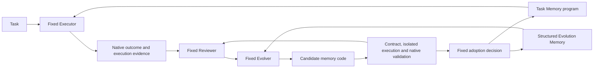

# EvoMemory

**Evolving agent memory mechanisms with structured experience from earlier mechanism changes.**

EvoMemory evolves the program that supplies memory to a fixed Executor. A
fixed Reviewer diagnoses observed behavior. Evolution Memory stores evidence
from earlier edits for subsequent proposals.

| Workflow | Entry point | What can change |
|---|---|---|
| Online task stream | `python -m math_apps_online` | The Task Memory program, with feedback on the same task |
| ALMA campaign | `python -m phase1_codegen` | The Task Memory program across a registered campaign |
| [Paired proposal-policy search](docs/rsi_paired.md) | `python -m rsi_paired` | The Task Memory program and the Evolver's proposal policy |

From this paired-search checkout, run `python -m rsi_paired`. Both proposal policies generate fresh mechanisms
from the same starting program, learning state and external evidence.
See the [English run guide](docs/rsi_paired.md) or the
[中文运行说明](docs/rsi_quickstart_zh.md) for the six-task native smoke test.
The [formal ALFWorld guide](docs/rsi_formal_alfworld.md) describes six rounds per task
family, the sequential transfer of Evolution Memory and the paired 100-game final tests.

## Task Memory evolution



Every memory program implements `on_event(state, event, context)`. The fixed
events are `task_start`, `before_action`, `after_observation`, and `task_end`.
The implementation controls its state, session, and memory output within fixed
interfaces and resource limits. Generated Python runs in isolated Linux workers
with language validation, syscall filtering, and CPU/memory/output budgets.

The online stream keeps Task Memory local to each task family while sharing
Evolution Memory within a dataset. Accepted code carries across families.
The registered ALMA campaign has its own environment-wide continuity protocol.
Different datasets/environments never share their memory stores implicitly.

## Install

Use **Linux and Python 3.10 or 3.11**. The isolation layer requires `libseccomp`;
there is no unrestricted execution fallback.

```bash
git clone --branch rsi-original-parent-paired-v3 https://github.com/mingbo-yang/EvoMemory.git
cd EvoMemory
python3.10 -m venv .venv
source .venv/bin/activate
pip install -e '.[models,data,dev]'
# Debian/Ubuntu: sudo apt-get install libseccomp2 git
```

Start your own local OpenAI-compatible model endpoint separately. EvoMemory
does not start, stop, drain, or acquire other users' model services. Configure
the checkpoint and served model name explicitly:

```bash
cp .env.example .env
# Edit the checkpoint path in .env, then:
source .env
python -m scripts.register_model --model "$EVOMEMORY_MODEL_PATH" \
  --output "$EVOMEMORY_MODEL_MANIFEST"
python -m math_apps_online --help
```

The checkpoint registration hashes metadata and records weight-shard sizes;
it is not a full hash of the model weights. The endpoint must advertise the
expected model/checkpoint identity. Only configured loopback HTTP endpoints
are permitted. No remote API credentials are needed or forwarded.

## Prepare data and run

Download benchmarks explicitly under their upstream terms. Setup commands do
not call a model or execute a task. APPS downloads exceed 1 GB, plus the author
archive used for identity verification.

```bash
python -m scripts.prepare_assets alma
python -m scripts.prepare_assets math
python -m scripts.prepare_assets apps
# Optional native embodied benchmark:
pip install -e '.[alfworld]'
python -m scripts.prepare_assets alfworld
```

MATH uses eligible integer-answer algebra/number-theory questions, not the full
MATH score. APPS uses its native call-based and standard-I/O interfaces.
ALFWorld uses the official 200-instance EvoMemBench CrossEp-Emb mapping with
ALMA's original action loop and a 30-action budget. This is EvoMemory's online
protocol on those instances, not a reproduction of the benchmark leaderboard.

```bash
# Outcome-blind plans; do not run the task stream:
python -m math_apps_online plan math --per-family 8
python -m math_apps_online plan apps --per-family 8
python -m math_apps_online plan alfworld --per-family 2

# Each condition needs its own fresh output directory:
python -m math_apps_online run math --per-family 8 \
  --condition no_external_em --output runs/math_control_seed11
python -m math_apps_online run math --per-family 8 \
  --condition cross_type_em --output runs/math_transfer_seed11
```

On a failed first attempt the fixed Reviewer diagnoses, Evolution Memory is
retrieved, and the Evolver gets a proposal opportunity. Candidate validation is
on the same item. An evidence-grounded adoption also requires native **0 → 1**;
the Reviewer can request continuation or stop. The online repair loop has no
fixed proposal-count or aggregate-cost cap, so record and monitor actual costs.
The two conditions must use identical item order, initial program, model,
seeds, permissions, and resource settings.

Report **first-attempt accuracy** separately from **eventual solved rate after
feedback**. A repaired answer is not evidence of an unseen-task transfer gain.
Compare subsequent first attempts, including new families, with actual costs.

See [online protocol](docs/online_protocol.md),
[ALMA campaign protocol](docs/alma_campaign.md),
[configuration](docs/configuration.md), and
[data preparation](docs/datasets.md) for details.

## Repository layout

| Directory | Purpose |
|---|---|
| `phase1_codegen/roles/` | Fixed Reviewer and Evolver implementations |
| `phase1_codegen/reporting/` | Offline experiment reports |
| `phase1_codegen/` | Event contract, memory execution, evidence, orchestration, adoption |
| `rsi_paired/` | Paired proposal-policy search, native smoke run and receipt audit |
| `math_apps_online/` | Transactional online task-stream scheduling and reporting |
| `evomem/` | ALMA/model transport and common infrastructure |
| `benchmarks/` | Pinned MATH/APPS and CrossEp-Emb adapters and host-side judging |
| `scripts/` | Explicit checkpoint registration and upstream asset preparation |
| `tests/core/`, `tests/online/`, and release tests | CPU contracts, separate from installed runtime code |
| `docs/` | Method, setup, protocol, and release limitations |

## Tests and evidence

See the [architecture and code map](docs/architecture.md) for module ownership,
entry points, and the full development-test commands. Workflow documentation is
maintained under `docs/` rather than duplicated inside runtime packages.

```bash
python -m pytest -q
python -m build
```

Native integration tests require separately prepared assets and are skipped
when these assets are absent. Unit tests and fake transports are not research
results. The paired branch documents its native engineering validation separately.
See [release scope](docs/release_scope.md) for portability edits and validation.

## License and upstream projects

Original EvoMemory code is released under the [MIT License](LICENSE).
ALMA, benchmark datasets, model weights, and other upstream assets retain their
own terms; they are downloaded separately and are not covered by this license.
See [third-party notices](THIRD_PARTY_NOTICES.md).

Please use [GitHub Issues](https://github.com/mingbo-yang/EvoMemory/issues) for
bugs and reproducible reports. See [CONTRIBUTING.md](CONTRIBUTING.md).
